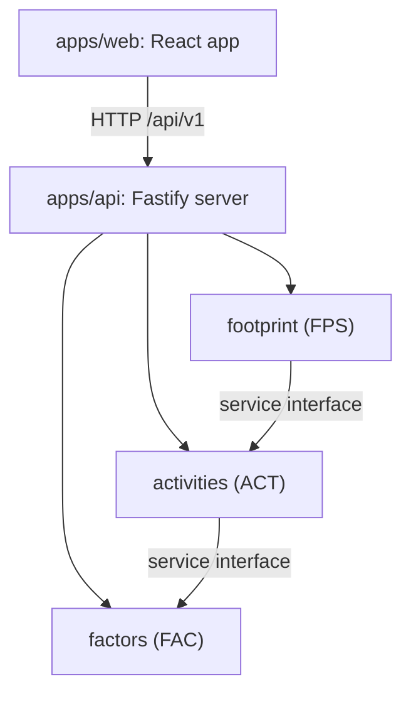
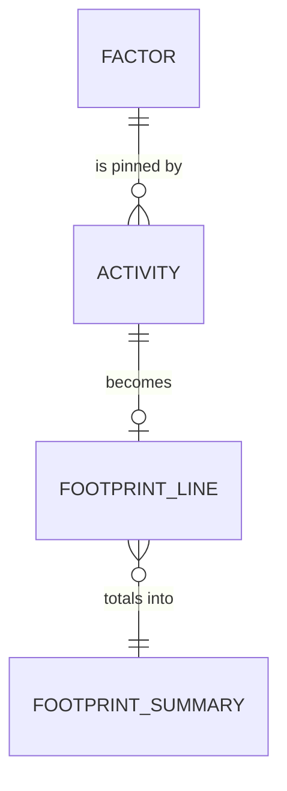

# Architecture Spine: Carbon Hub Lite

Carbon Hub Lite is a small sample that derives from the real Carbon Hub master spine. It reuses three real ideas in simplified form: one writer per aggregate (real AD-3), reproducible calculation (real AD-7) and rules as data (real AD-14). It is a separate, much smaller document.

Stack note: the production Carbon Hub is C# on .NET with React. This sample uses Node.js and TypeScript so it runs on any laptop. The sample stack is not a recommendation for production.

Workshop sample values, not real emission factors.

## Design Paradigm

Modular monolith. One API process and one web app. Inside the API, three modules each own their data and expose a service interface. Modules never reach into each other's repository.

| Layer | Holds | Rule of thumb |
| --- | --- | --- |
| Web app | Screens, forms, tables | Talks to the API only. Never calculates a figure |
| API routes | HTTP parsing, status codes, problem+json | Thin. Calls one service |
| Service | Business rules, validation, calculation | The only way into a module from outside |
| Repository | Storage of the module's own data | Used only by its own service |

Modules: `factors` (FAC), `activities` (ACT), `footprint` (FPS).

## Invariants & Rules



Only the two module arrows are allowed. Footprint reaches factors through activities, which hold the pinned factor id. It never asks for "latest".

### AD-1: Modules and one-way dependency [ADOPTED]

- **Binds:** factors, activities, footprint, all code under `apps/api/src/modules`, `modules.yaml`
- **Prevents:** circular imports, the factors module knowing about activities, hidden coupling that blocks later change.
- **Rule:** footprint depends on activities, which depends on factors. No other direction is allowed. No cycles. `modules.yaml` `may_call` lists exactly these.

### AD-2: One writer per aggregate [ADOPTED]

- **Binds:** FAC, ACT, FPS, every repository
- **Prevents:** two modules writing the same data, lost updates, unclear ownership.
- **Rule:** factors owns factors. activities owns activities. footprint owns nothing durable and computes on read.

### AD-3: Factors are immutable and versioned [ADOPTED]

- **Binds:** FAC.FR-1, FAC.FR-2, FAC.FR-3, FPS.FR-1
- **Prevents:** a past footprint changing because a factor was edited.
- **Rule:** a factor is never edited. A new value is a new version with a new id, for example `EF-DIESEL-UK-2026.1` then `EF-DIESEL-UK-2027.1`.

### AD-4: Decimal only [ADOPTED]

- **Binds:** ACT.FR-1, ACT.FR-2, FPS.FR-1, FPS.FR-2, CLT.NFR-1
- **Prevents:** float rounding errors such as 0.1 + 0.2, silent drift between screens.
- **Rule:** quantities and factors travel and are stored as decimal strings. Arithmetic uses decimal.js. Never use floats. Rounding happens only in the footprint calculation: kg CO2e to 2 decimal places half up, t CO2e to 3 decimal places.

### AD-5: Every figure carries a status [ADOPTED]

- **Binds:** FPS.FR-2, FPS.FR-3
- **Prevents:** an unverified number being read as a verified one.
- **Rule:** every emissions figure carries a status of Verified or Indicative. Carbon Hub Lite only produces Indicative. The web app shows the status next to the number.

### AD-6: An activity pins its factor [ADOPTED]

- **Binds:** ACT.FR-1, FPS.FR-1, CLT.NFR-2
- **Prevents:** a footprint changing when a newer factor is published, non-repeatable results.
- **Rule:** an activity stores the factor id at creation. Calculation uses that id. It never looks up "latest".

### AD-7: API conventions [ADOPTED]

- **Binds:** all modules, `apps/web`, CLT.NFR-3
- **Prevents:** each endpoint inventing its own shape, clients that need special cases.
- **Rule:** all routes live under `/api/v1`, except `GET /health`. Bodies are JSON. Errors are problem+json (RFC 9457) with `type`, `title`, `status` and `detail`. List responses are `{count, items}`. Validation errors add an `errors` array.

### AD-8: Module code layout [ADOPTED]

- **Binds:** all API code
- **Prevents:** logic scattered across files, modules importing each other's internals.
- **Rule:** each module lives in `apps/api/src/modules/<slug>/` with `routes.ts`, `service.ts`, `repository.ts` and `types.ts`. Modules talk only through service interfaces.

### AD-9: Stack and versions [ADOPTED]

- **Binds:** all apps, CLT.NFR-5
- **Prevents:** setup problems on participant laptops, mixed tooling.
- **Rule:** use the stack in the Stack section. Do not add a database, an ORM or a UI framework without a new decision.

### AD-10: Testing [ADOPTED]

- **Binds:** every ticket, CLT.NFR-4
- **Prevents:** tickets marked done with no proof.
- **Rule:** API tests use `fastify.inject` in `apps/api/test`, one file per endpoint group. A ticket is done only when each acceptance criterion has a passing test, or a stated manual check for a screen.

## Consistency Conventions

| Concern | Convention |
| --- | --- |
| Naming | Files and folders are kebab-case. Types are PascalCase. JSON fields are camelCase. Activity types are snake_case values: `diesel`, `petrol`, `natural_gas`, `lpg`, `grid_electricity`, `district_heat` |
| Ids | Factor ids look like `EF-DIESEL-UK-2026.1`. Activity ids are sequential strings: `ACT-0001` |
| Periods | `YYYY` or `YYYY-MM`. Nothing else |
| Dates and times | `validFrom` is `YYYY-MM-DD`. `createdAt` is ISO 8601 in UTC |
| Decimals | Strings in JSON, with `.` as the separator. Example: `"2.70"`, `"0.183"` |
| Errors | problem+json. Status codes: 400 bad query, 404 unknown id, 422 invalid body |
| Lists | `{count, items}`. Factor lists are ordered by label ascending |
| Seeding | Seed data is in memory, uses fixed ids and is idempotent. Seeding twice never duplicates |
| Web | Plain CSS with design tokens from the shared UX design (`initiative-fac-factor-library/ux-fac-factor-library/DESIGN.md`). The web app formats numbers for display only and never calculates |
| Notices | Any screen that shows factor numbers shows: "Workshop sample values, not real emission factors." |

## Stack

| Name | Version |
| --- | --- |
| Node.js | 24 LTS (works on 20 and above) |
| TypeScript | 5 |
| Fastify | 5 |
| Vitest | 2 (API tests in process with `fastify.inject`) |
| decimal.js | 10 |
| React | 19 |
| Vite | 5 |
| npm workspaces | `apps/api`, `apps/web` |

Plain CSS with design tokens. Storage is in memory, seeded on start. The versions the code actually installs are pinned by `package-lock.json`.

## Structural Seed

```text
package.json                   npm workspaces
tsconfig.base.json
modules.yaml                   module slugs, owners, may_call (AD-1)
apps/
  api/
    src/
      app.ts                   builds the Fastify app, seeds, registers routes
      server.ts                starts the server
      modules/
        factors/               FAC: routes.ts, service.ts, repository.ts, types.ts
        activities/            ACT: same four files
        footprint/             FPS: same four files
    test/                      one test file per endpoint group
  web/
    src/
      App.tsx                  shell with header and three tabs
      pages/                   one file per screen
      api/                     one client file per module
      styles.css               design tokens and base styles
```

footprint has a repository file for layout consistency only. It holds no durable data (AD-2).



FACTOR belongs to factors. ACTIVITY belongs to activities. FOOTPRINT_LINE and FOOTPRINT_SUMMARY are computed on read by footprint and stored nowhere (AD-2). Links between modules are ids only.

## Capability → Architecture Map

| Capability / Area | Lives in | Governed by |
| --- | --- | --- |
| FAC.FR-1 List emission factors | factors, `apps/web` Factors tab | AD-2, AD-3, AD-7, AD-8 |
| FAC.FR-2 Filter factors | factors | AD-7, AD-10 |
| FAC.FR-3 Factor detail by id | factors | AD-3, AD-7 |
| ACT.FR-1 Record an activity | activities | AD-1, AD-2, AD-4, AD-6 |
| ACT.FR-2 Validate activity input | activities | AD-4, AD-7 |
| ACT.FR-3 List activities | activities | AD-2, AD-7 |
| FPS.FR-1 Calculate per activity | footprint | AD-1, AD-3, AD-4, AD-6 |
| FPS.FR-2 Total by scope | footprint | AD-2, AD-4, AD-5 |
| FPS.FR-3 Show status | footprint, `apps/web` Footprint tab | AD-5 |
| CLT.NFR-1 Precision | all modules | AD-4 |
| CLT.NFR-2 Determinism | footprint, activities | AD-3, AD-6 |
| CLT.NFR-3 Error format | all modules | AD-7 |
| CLT.NFR-4 Test evidence | every ticket | AD-10 |
| CLT.NFR-5 Runs anywhere | all apps | AD-9 |

## Deferred

| Item | Why it can wait |
| --- | --- |
| Persistent storage and migrations | In-memory is enough for the sample |
| Authentication, organisations and roles | One persona, no sign-in in R1 |
| Scope 3 activity types and factors | Out of scope in the master PRD |
| Factor import and new factor version publishing | Factors are seeded in R1 |
| Verified status and the verification flow | Nothing is verified in the sample |
| Editing and deleting activities | Out of scope in the master PRD |
| Pagination, caching headers and a not-found handler in problem+json for unknown routes | Not needed for six read-only factors. Decide once for all read endpoints when a need appears |
